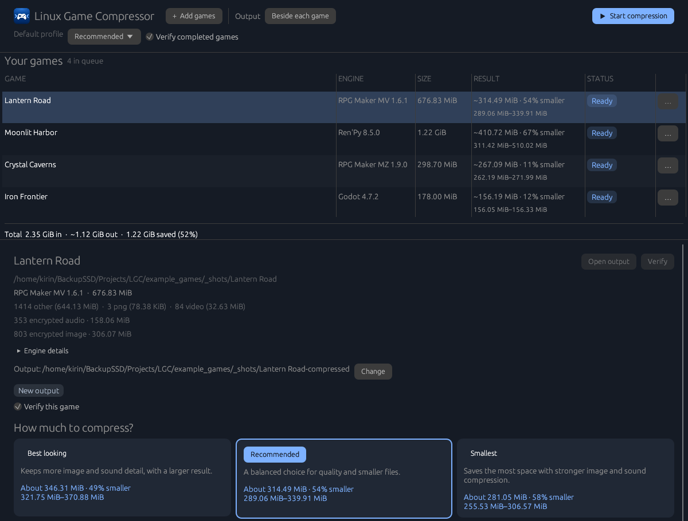

<p align="center">
  
</p>

<h1 align="center">Linux Game Compressor</h1>

<p align="center">
  Make Ren'Py, Godot, Unity and RPG Maker games smaller without breaking them.
</p>

<p align="center">
  <a href="https://github.com/kirin-3/linux-game-compressor/actions/workflows/ci.yml"></a>
  <a href="https://github.com/kirin-3/linux-game-compressor/releases/latest"></a>
  <a href="LICENSE"></a>
</p>

<p align="center">
  
</p>

Linux Game Compressor copies a game to a new folder and re-encodes its images,
audio and video into much smaller formats: images to WebP, audio to
Opus, Vorbis or MP3, and video to VP9 WebM. Every file keeps its original name
and path, so the engine loads the output exactly as before. Your original
game is never modified.

## Features

- **Drop and go.** Drop game folders on the window, press **Start
  compression**, done. Games are queued and compressed one after another.
- **Know before you compress.** Each game shows an estimated output size for
  every profile, worked out in seconds by encoding a sample of its files.
- **Three simple profiles.** **Best looking**, **Recommended** and
  **Smallest**, or fine-tune image, audio and video quality per game.
- **Safe by design.** Output goes to a separate folder and is never
  overwritten. A file that fails to convert, or wouldn't get smaller, is kept
  as is. Each output is verified against its manifest when it finishes.
- **Resumable.** An interrupted job continues where it stopped.
- **Engine-aware.** Rebuilds Godot `.pck` packs, re-encrypts RPG Maker
  assets with the game's key, and repacks Unity player data losslessly.
- **One file.** The desktop app and the command-line tool are a single
  executable with identical settings. Nothing to unpack.

## Supported games

| Engine | Versions | What gets compressed |
| --- | --- | --- |
| Ren'Py | 6.99.12 and newer | Loose images, audio and video. `.rpa` archives are copied unchanged. |
| Godot 4 | 4.x | Images and audio, including members of `.pck` packs, which are rebuilt. |
| RPG Maker MV / MZ | MV and MZ | Images, audio and video, including encrypted assets; unused `.m4a` twins are removed. |
| Unity | 2020.1 – 2023.2, Unity 6 | Player data repacked into a lossless LZ4HC `data.unity3d`. |

See [docs/compatibility.md](docs/compatibility.md) for results on real games
and the details for each engine.

## Install

### 1. Install the encoders

Linux Game Compressor uses `cwebp`/`dwebp`/`webpinfo` and `ffmpeg`/`ffprobe`
(with libvpx-vp9, libopus, libvorbis and libmp3lame).

```sh
# Arch Linux, CachyOS, Manjaro
sudo pacman -S libwebp-utils ffmpeg
```

```sh
# Debian, Ubuntu, Linux Mint
sudo apt install webp ffmpeg
```

```sh
# Fedora (ffmpeg from RPM Fusion)
sudo dnf install libwebp-tools ffmpeg
```

The app shows a banner if any tool is missing.

### 2. Get Linux Game Compressor

Linux Game Compressor is a single file: the desktop app and the command-line
tool in one. It runs on x86-64 Linux with glibc 2.35 or newer (Ubuntu 22.04,
Debian 12, Fedora 36 and later, and any current Arch-based distribution).

Download it from
[Releases](https://github.com/kirin-3/linux-game-compressor/releases/latest),
or from a terminal:

```sh
curl -LO https://github.com/kirin-3/linux-game-compressor/releases/latest/download/linux-game-compressor
chmod +x linux-game-compressor
./linux-game-compressor
```

To add it to your app menu and your `PATH`, run once:

```sh
./linux-game-compressor install
```

This copies it to `~/.local/bin` and adds a menu entry and icon. To update,
download the new version and run `install` again.
`linux-game-compressor uninstall` removes it again.

### Build from source

Install Rust 1.88 or newer, then:

```sh
git clone https://github.com/kirin-3/linux-game-compressor.git
cd linux-game-compressor
cargo build --release
```

The program is `target/release/linux-game-compressor`.

## Desktop app

Open **Linux Game Compressor** from your app menu, or run
`linux-game-compressor` without arguments.
Drop game folders onto the window or choose **Add games**. The toolbar's **Output** control
chooses a common output folder; **Reset** returns to placing each output beside
its input. Choose the default profile and whether finished games are verified,
then press **Start compression**. **Stop queue** stops after the current game.

The queue lists each game's engine, input size, estimated or actual result, and
status. Select a row for its details. Its menu can move or remove a game, open
its output, or cancel a running game. Totals combine actual results and estimates.
Estimates are marked with `~` and include a range; they are calculated in the
background from encoded samples and replaced by actual sizes after compression.

In the details, choose **Best looking** (`quality`), **Recommended** (`balanced`),
or **Smallest** (`small`). Adjust image, audio, video, and engine settings for
that game; less common controls are under **More options**. Changed controls
can be reset individually, and **Back to…** restores the chosen profile.
The panel also lets you change the game's output folder, choose verification,
open or verify a completed output, and expand **Problems** for files that
failed to convert or verify, or **Kept unchanged** for files left as they were
and why. A missing-tools banner appears when tools are needed.

On Linux the app uses X11 when `DISPLAY` is available, including XWayland on
Wayland desktops, to support folder drops. Without `DISPLAY`, it uses Wayland
and **Add games** remains available. Set `COMPRESSOR_GUI_BACKEND=wayland` to
choose native Wayland; drag and drop is unavailable there.

Preferences are saved in `~/.config/compressor/gui.toml` (or under
`$XDG_CONFIG_HOME/compressor/gui.toml` when set). The queue is not saved.
Keep each output's `.compressor/` directory to resume or verify it. Files added
by hand inside an interrupted output may be replaced when that job resumes.

## Command line

Run `linux-game-compressor --help` for every command. Set `GAME` to the input game directory, `OUTPUT` to a separate output path,
and `PLAN` to a path for a saved plan. With `linux-game-compressor` on your
`PATH`:

```sh
linux-game-compressor inspect "$GAME"
linux-game-compressor inspect "$GAME" --json
linux-game-compressor settings --engine renpy --profile small --set image.quality=70
linux-game-compressor settings "$GAME" --json
linux-game-compressor plan "$GAME" --profile balanced --list
linux-game-compressor plan "$GAME" --profile small --set audio.vorbis_quality=2 --save "$PLAN"
linux-game-compressor compress "$GAME" --output "$OUTPUT" --plan "$PLAN" --jobs 2
linux-game-compressor verify "$OUTPUT"
linux-game-compressor verify "$OUTPUT" --json
```

`inspect` only reads the game; `plan` writes only the optional saved plan.
`compress` also accepts `--profile balanced`, `quality`, or `small` instead
of `--plan`, and `--allow-unknown-version` to override the engine version
gate. `plan` and `compress` accept repeatable `--set key=value` overrides;
they cannot be combined with a saved `--plan`. Use `settings` to see effective
values, their sources, and engine options. A profile can be a TOML file:

```toml
name = "custom"
base = "quality"

[image]
quality = 88
effort = 6
sharp_yuv = true
reencode_webp = false

[audio]
opus_kbps_per_channel = 48
vorbis_quality = 3
mp3_kbps_per_channel = 64

[video]
crf = 36
effort = 3
opus_kbps_per_channel = 48

[engines.rpgmaker]
remove_unused = true

[engines.godot]
min_texture_kib = 4

[engines.renpy]
ogg_target = "vorbis"

[engines.renpy.image]
quality = 78
```

The default `balanced` profile uses quality 82 and effort 4. `quality` uses
90 and 6; `small` uses 72 and 6 and permits re-encoding still WebP images
under eligible filenames. Animated images, presplash images, and icons are
not converted. Any failed or non-smaller conversion keeps the original.

Converted files retain their original names and extensions. Images contain
WebP bytes; Ogg audio defaults to Opus unless `ogg_target` selects Vorbis,
and MP3 remains MP3. Tools that assume extensions match content may not
recognize converted files. WAV and native FLAC are copied unchanged; Ogg FLAC is supported.

For RPG Maker MV or MZ, the same commands preserve encrypted asset names and
re-encrypt converted assets with the game key. Ogg audio remains Vorbis;
unused M4A twins are removed by default. Disable that with
`--set engines.rpgmaker.remove_unused=false`. Videos become VP9/Opus WebM
under their original names, including `.mp4` or `.avi` names. Video settings
are `video.crf` (0–63), `video.effort` (0–5), and
`video.opus_kbps_per_channel` (6–256). See
[compatibility](docs/compatibility.md#rpg-maker-mv-and-mz) for details.

For a Godot 4 export, use the same `inspect`, `plan`, `compress`, and `verify`
commands. Pack members are shown as `pack.pck::member`. Set the minimum
texture size with `--set engines.godot.min_texture_kib=4` (KiB; default 4).
For example, `linux-game-compressor plan "$GAME" --set engines.godot.min_texture_kib=4 --list`
shows the affected members. See [compatibility](docs/compatibility.md#godot-4)
for supported packs and resources.

Allow enough disk space for the complete output, staged converted members,
and a temporary rebuilt pack. Staged members are kept in `.compressor/` for
resume and verification.

The output's `.compressor/` directory stores the plan, journal, manifest,
report, and temporary working files. Keep it to resume an interrupted job
and run `verify`. It can be removed from a distribution, but verification
and resumption then require it to be recreated by a new job.

Exit codes are 0 for success, 1 when some conversions failed and kept their
originals, 2 for usage or precondition errors, and 130 for interruption.

## How it works

1. **Inspect.** The game's engine and version are detected, and unsupported
   versions are refused.
2. **Plan.** Every file is classified as convert, copy or remove. Pack members
   are planned individually.
3. **Compress.** The game is copied to the output folder while eligible files
   are encoded in parallel. Each result is checked, and kept only if it is
   valid and smaller.
4. **Verify.** The output is checked against the recorded manifest.

## Contributing

Bug reports and pull requests are welcome. Please run these before sending a
change:

```sh
cargo fmt --all --check
cargo clippy --workspace --all-targets -- -D warnings
cargo test --workspace
```

To publish a release, push a tag such as `v0.1.0`. The
[release workflow](.github/workflows/release.yml) builds the binary and
attaches it, with its SHA-256 checksum, to a GitHub release.

## License

Linux Game Compressor is licensed under the
[GNU General Public License v3.0](LICENSE). Licenses of bundled third-party
crates are listed in [THIRD_PARTY.md](THIRD_PARTY.md), and
`linux-game-compressor licenses` prints both.
